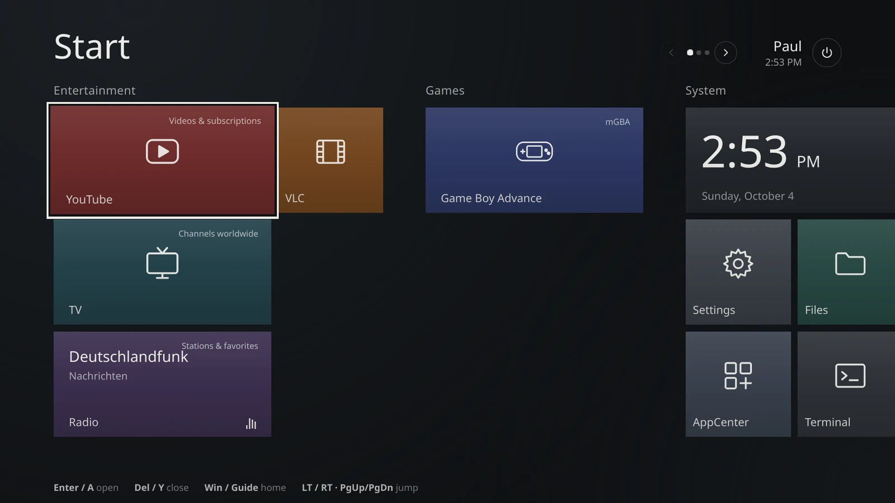
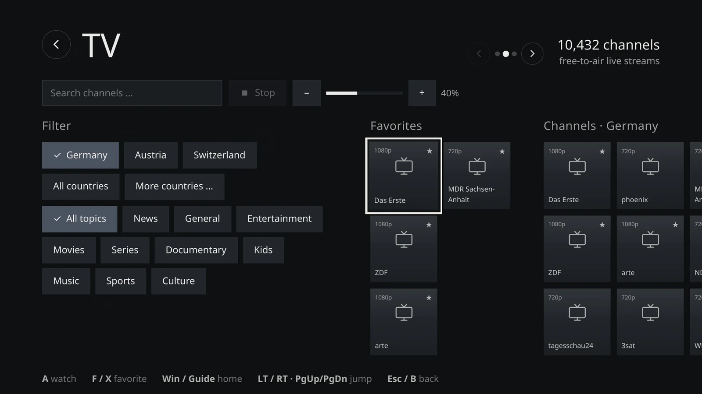
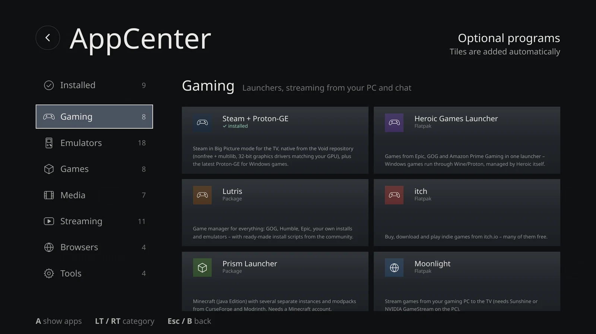
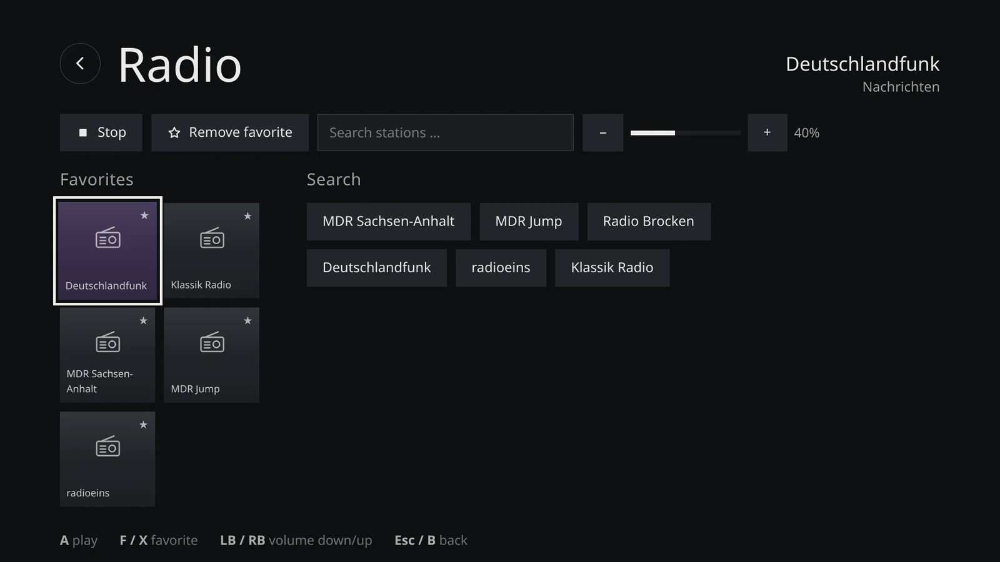
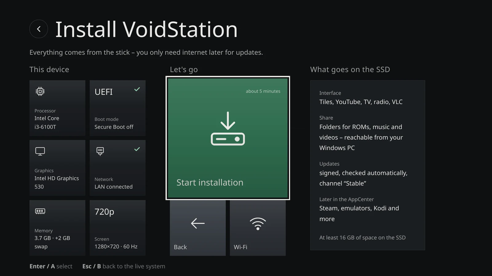
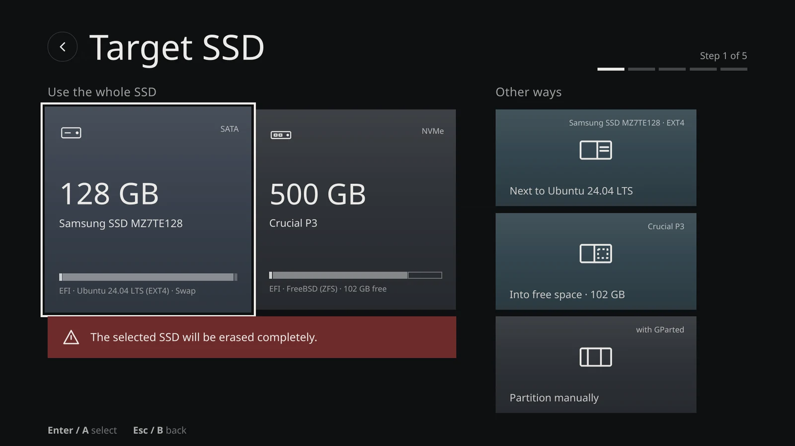

# VoidStation

English · **[Deutsch](README.de.md)** · [voidstation.de](https://voidstation.de/en/) · [Download](https://voidstation.de/en/download/) · [Questions](https://github.com/Panther92/VoidStation/discussions) · [Report a bug](https://github.com/Panther92/VoidStation/issues/new/choose)

[](https://github.com/Panther92/VoidStation/releases/latest) [](https://github.com/Panther92/VoidStation/actions/workflows/checks.yml) [](LICENSE) [](https://sourceforge.net/projects/voidstation/files/) [](https://distrowatch.com/table.php?distribution=voidstation)

Void Linux as a TV station: a dark tile interface in the style of Windows 8, controlled with a gamepad, remote, mouse or keyboard.
It runs on Openbox; the start screen is a dedicated Python + Qt 6 program that draws straight on the GPU.
The installer in the live system is Qt as well. The former web interface (WebKitGTK) was removed in 2026.12.

**Features:** YouTube (Firefox in kiosk mode), radio with search and favorites, TV channels from around the world (iptv-org) in its own player
(switch channels in the picture, channel list, program info), **Videos & Music** (library for the share and USB drives with covers,
continue watching, repeat/shuffle, “Find music” with downloads including tags and cover), emulators, an AppCenter for optional apps (Void packages, unpacked builds from the makers, web), settings (language, scaling, resolution,
audio output, Wi-Fi, Bluetooth, mouse pointer), a Samba share `\\<hostname>\share`, several apps side by side with switching.
Interface in **English or German**, plus thirty-two machine-translated languages: Bahasa Indonesia, Bahasa Melayu, Čeština, Dansk, Eesti, Español, Français, Íslenska, Italiano,
Latviešu, Magyar, Nederlands, Norsk bokmål, Polski, Português (Brasil), Română, Slovenčina, Suomi, Svenska, Tiếng Việt, Türkçe, Ελληνικά, Русский, Українська, हिन्दी, தமிழ், മലയാളം, ไทย, 日本語, 한국어, 简体中文, 繁體中文 (Settings → Language). From the 2026.11 live ISO on, the installer and the stick's boot menu speak all languages too (those added since the 2026.11 live ISO from the next live ISO).
The display server is [XLibre](https://github.com/X11Libre/xserver) (templates from [xlibre-void](https://github.com/xlibre-void/xlibre), built and signed in VoidStation's own package repository [voidstation-packages](https://github.com/Panther92/voidstation-packages));
X.Org is not used. If the interface fails to start twice, VoidStation reinstalls XLibre once;
after that, a rescue console appears. By hand: `sudo /usr/local/sbin/voidstation-pkg xserver ensure|repair|status`.
Remote access via SSH can be switched on and off under Settings → System.



| TV | AppCenter | Radio |
|---|---|---|
|  |  |  |

| TV player | Videos | Music |
|---|---|---|
|  |  |  |

| Library | Find music | Sound |
|---|---|---|
|  |  |  |

| Installer | Installer: target SSD |
|---|---|
|  |  |

Picture in the TV player and in “Videos”: “Big Buck Bunny” © Blender Foundation | [peach.blender.org](https://peach.blender.org), [CC BY 3.0](https://creativecommons.org/licenses/by/3.0/). Everything else in the screenshots is sample data.

## Installation

VoidStation is installed **exclusively from the live ISO**:
**[Download at voidstation.de](https://voidstation.de/en/download/)** (hosted on [SourceForge](https://sourceforge.net/projects/voidstation/files/)).

1. Download the ISO and verify it (see [Verifying the download](#verifying-the-download)).
2. Copy it onto a [Ventoy](https://www.ventoy.net) stick or write it with [Rufus](https://rufus.ie) / [balenaEtcher](https://etcher.balena.io).
3. Turn off Secure Boot, boot from the stick, pick the language in the boot menu and then *Start VoidStation Live*
   (with NVIDIA from GTX 16xx / RTX 20xx on: *… (NVIDIA only)*).
4. Try out the live system, then use the **Install VoidStation** tile: whole SSD, next to Windows or Linux,
   into free space or partitioned manually with GParted. About five minutes, no internet needed.

**Minimum:** 64-bit PC (x86_64), 4 GB RAM, 16 GB on the SSD, Secure Boot off.

## Live ISO with installer

The live ISO is a complete VoidStation to try out (YouTube, TV, radio, Videos & Music) with the **Install VoidStation** tile.
The installer uses the same tile design, in English or German, and copies the live system to the SSD –
it doesn't need internet for that.

- **Paths:** whole SSD · next to Windows or Linux (NTFS, ext4 or btrfs is shrunk) · into free space
  (e.g. next to FreeBSD) · manual partitioning with GParted. With several systems there is a short GRUB boot menu;
  next to Windows, the hardware clock runs on local time.
- **Minimum:** 64-bit PC, 4 GB RAM, 16 GB on the SSD, Secure Boot off. If something is missing, the installer says what to do.
- **Boot mode:** UEFI supports every path. In BIOS mode (Legacy/CSM, e.g. older PCs or VirtualBox/QEMU with
  default settings) only “whole SSD” is available: GPT with a BIOS boot partition, GRUB for BIOS and additionally
  for UEFI – the SSD then boots in both modes.
- **Boot menu of the stick:** with logo – first the language (*Deutsch* / *English*, sets interface, installer and keyboard),
  below it *Start VoidStation Live* (free drivers) and *… (NVIDIA only)* (NVIDIA driver for GeForce GTX 16xx / RTX 20xx
  and newer) · *Reboot*. A splash screen with the logo appears while booting.
  Installing from “NVIDIA only” keeps the NVIDIA driver in the installed system – otherwise the installer removes it
  again (along with DKMS and the compiler).
- **Errors:** Every step can be retried, the boot manager also “another way” (fallback loader instead of an NVRAM entry).
  Log: `/run/voidstation-installer/install.log`, can be saved to a USB stick.
- **Terminal:** `sudo voidstation-installer text` (whole SSD only) · `probe` shows what the installer detects.

### Verifying the download

Next to every ISO on SourceForge there is a `.sha256` file and its signature `.sha256.sig`:

```sh
sha256sum -c voidstation-<version>-<date>.iso.sha256
curl -fsSL https://raw.githubusercontent.com/Panther92/VoidStation/stable/keys/voidstation-release.pub \
  | awk '{print "voidstation-release namespaces=\"voidstation\" "$1" "$2}' > voidstation-signers
ssh-keygen -Y verify -f voidstation-signers -I voidstation-release -n voidstation \
  -s voidstation-<version>-<date>.iso.sha256.sig < voidstation-<version>-<date>.iso.sha256
```

On Windows: `certutil -hashfile voidstation-<version>-<date>.iso SHA256` and compare with the sum on the download page.

### Building the ISO

On a Void system (e.g. a VoidStation), takes 25–50 minutes. Official ISOs are built from the `stable` branch:

```sh
git clone https://github.com/Panther92/VoidStation && cd VoidStation   # or: git fetch in an existing clone
git show origin/stable:dist/build-iso.sh > /var/tmp/build-iso.sh
sudo bash /var/tmp/build-iso.sh
```

The ISO ends up in `~/share/ISO/` (with `.sha256`); your own radio and TV favorites come along.

## Updates

**On the TV:** Settings → Updates → *Update* – the only update button. It checks and installs everything in one go:
Void packages (including the kernel), Flatpaks, AppImages, Proton-GE and VoidStation itself (in that order; anything
up to date is skipped). Devices check shortly after startup and then every 6 hours on their own. New VoidStation
versions are announced right away at the bottom right – the update brings pending system updates along. System-only
updates are only flagged once the system has been out of date for 30, 60 or 90 days (Settings → Updates →
*Remind about system updates after*, default 90). The update dialog shows what's new and which packages are coming.
Your tiles, favorites and settings are kept. A restart is only requested after a new kernel or a new VoidStation version.

**In the terminal:** `vsctl update` does the same as the button (with a live log). `sudo xbps-install -Su`
updates only the Void packages – that still works, and VoidStation notices it (finished updates disappear from
the display, after a new kernel “Restart required” appears at the bottom right). VoidStation itself is not an
xbps package and only comes via the button or `vsctl update`.

**Channels:** *Stable* (branch `stable`) for every device, and *Testing* (branch `main`), the development state –
new versions first, untested. Since 2026.11 the installer and the settings no longer offer Testing; testers switch
in the terminal with `vsctl channel testing` (back with `vsctl channel stable`).
Every version released to *Stable* is tagged `v<version>` and listed under
[Releases](https://github.com/Panther92/VoidStation/releases) – with a link to its live ISO, if that version has one.

**Versions** follow the calendar: `2026.11` is the release of November 2026, hotfixes to it are `2026.11.1`,
`2026.11.2` … New features go to *Testing* first; the monthly release train takes to *Stable* what arrived
before the feature freeze, which starts on the Monday of the release week. A new live ISO comes out every three months. Details: [RELEASING.md](RELEASING.md).

**Signatures:** Updates run as root, so devices only install updates signed with the publisher's key
(`ssh-keygen -Y`, namespace `voidstation`). The public key is in `keys/voidstation-release.pub` and comes onto
the device with the ISO.

## Controls

| | Controller | Keyboard | Mouse |
|---|---|---|---|
| Move | D-pad / left stick | arrow keys | point, wheel scrolls |
| Open / select | A | Enter | click |
| Back | B | Esc / Backspace | right click |
| Close program, favorite | X / Y | Del, F, Y | ✕ on the tile |
| Next / previous group | RT / LT | PgDn / PgUp | arrows at the top right |
| Volume down / up | LB / RB | − / + | |
| Open update (when shown at the bottom right) | Select | U | click the hint |
| Power off, sleep | Start | – | ⏻ at the top right |
| Back to the start screen (from any program) | Guide / Home | Win | bottom right corner, then **Start screen** |
| Close a program (from inside it) | | | bottom right corner, then **Close app** |

In programs like Firefox, the right stick moves the mouse pointer (R2 click, L2 right click, R3 on/off).
Keys in the TV player and in “Videos & Music”: see the [help page](https://voidstation.de/en/help/#tv).

The arrows at the top right appear as soon as a page is wider than the screen; the bright dot shows the current group.
When updates are waiting (or a restart is needed after a new kernel), a yellow hint appears at the bottom right.

## Languages

All interface texts live in `launcher/web/i18n/<language>.json` (key → text, `{name}` = placeholder).
In code: `T('key', { name })` for texts, `L(text)` for tile, group and app names.
German and English are maintained by hand: new texts always go into **both** `de.json` and `en.json` –
`build.sh` aborts if a key or placeholder is missing in `en.json`.

The other languages (`es`, `fr`, `it`, `lv`, `hu`, `nl`, `pl`, `pt-BR`, `el`, `ru`, `uk`) were machine-translated –
corrections by native speakers are very welcome. A missing text falls back to English, then German, so a new
feature never breaks a language; `build.sh` lists how many texts are still English and rejects unknown keys or
wrong placeholders. Installer texts (`inst.*`) are not translated yet.

- New language: a line in `LANG_TABLE` in `launcher/launcher.py` (id, name in that language, locale, Firefox language)
  plus `launcher/web/i18n/<id>.json`. Formats live in the file itself: `fmt.locale`, `fmt.date` / `fmt.dateYear`
  (Qt date patterns), `fmt.clock` (`12`/`24`), `fmt.pct`; country names for the TV filter as `region.XX`.

- Choosing the language: Settings → Language. Without a choice, the session's `LANG` applies (`fr_FR…` → French, `pt_BR…` → Portuguese (Brazil), unknown → German).
- Programs started from tiles get `LANG`/`LANGUAGE` of the chosen language (PCManFM, GTK/Qt); Firefox profiles get
  `intl.locale.requested` and `intl.accept_languages` before every start. Programs with their own language setting (Steam, Kodi) keep it.
- Tiles: German default names (e.g. “Fernsehen”) are translated via `labels` in each language file; your own names stay as they are.
  Your own tiles can be bilingual too: `"label": {"de": "Fernsehen", "en": "TV"}`.
- AppCenter: descriptions via `app.<id>.desc` in the language file, otherwise the text from `catalog.json` applies; post-install
  hints (`note` in the catalog) via `app.<id>.note`. Categories come from `categories` in `catalog.json` (order =
  sidebar, name via `labels`, subtitle via `apps.catDesc.<category>`); the interface builds “Installed” itself.
- English means `en_US`: 12-hour clock (8:15 PM), dates and numbers in US format.

## Themes

**Settings → Appearance → Color scheme** offers several themes (e.g. `Dark`, `Light`, `High contrast`, `Nord`). The chosen theme is stored in `settings.json` and survives updates.

### Adding your own theme (drop-in)
New themes can be dropped in as a CSS file at `launcher/web/themes/<theme-name>.css`:

```css
/* launcher/web/themes/matrix.css */
:root[data-theme="matrix"] {
  --bg-main: #051008;
  --bg-radial-1: #0d2814;
  --bg-radial-2: #020a04;
  --surface-base: #0a1f10;
  --surface-raised: #10331b;
  --surface-card: #143d20;
  --surface-card-hover: #1c542c;
  --surface-active: #00ff66;
  --text-primary: #a3ffc2;
  --text-secondary: rgba(163, 255, 194, 0.75);
  --border-focus: #00ff66;
  --border-subtle: #1c542c;
  /* ... */
}
```

VoidStation picks up new CSS files in the theme folder automatically and offers them in the settings.

## Games, Bluetooth, program guide

- **Games:** copy ROMs into the share under `share/ROMs/<system>` (`gba`, `gbc`, `snes`, `nes`, `psx`, `psp`, `nds`, `gamecube`, `dreamcast` …). The emulator tile then shows a game list; without games, the emulator starts directly.
- **Bluetooth:** Settings → Bluetooth. Comes with `bluez` and `libspa-bluetooth` (audio via PipeWire); the user is in the `bluetooth` group. VoidStation runs its own pairing agent over D-Bus: “Just Works” is confirmed, legacy PIN devices get 0000/1234/1111, keyboard codes are shown on screen; requests are only accepted during a scan (+3 min). With several adapters the newest Bluetooth version wins (override: address in `/usr/local/share/voidstation/bt-adapter`).
- **Controllers:** udev rules give Steam, emulators and SDL direct access (hidraw, uinput) to controllers from all common brands. The start page understands standard pads, plain USB pads, joysticks and arcade sticks; custom mapping in `~/.config/voidstation/pads.json` (`{"<name or vid:pid>": {"<evdev code>": "a|b|x|y|lb|rb|lt|rt|select|start|up|down|left|right"}}`).
- **Program guide (EPG):** off by default. Turn it on by entering the address of an XMLTV file (`.xml` or `.xml.gz`):
  `echo 'https://…/epg.xml.gz' | sudo tee /usr/local/share/voidstation/epg-url`
  The file is downloaded daily, parsed in the background and cached as a small `~/.local/share/voidstation/cache/epg.json`.

## On the device

- Customize tiles: `~/.local/share/voidstation/tiles.json`
- Logs: `~/.local/share/voidstation/logs/`
- Restart the start screen (via SSH): `pkill -f voidstation-home.py` – `home.sh` brings it straight back

## Repository layout

| Path | Contents |
|---|---|
| `launcher/launcher.py` | Backend: HTTP API on 127.0.0.1:8765, starting/switching apps, radio, TV, AppCenter, settings |
| `launcher/qt/` | Start screen, player and installer (Python + Qt 6): `voidstation-home.py` (window, gamepad, texts, colors), `voidstation-player.py` (TV, Videos & Music via libmpv), `vscommon.py` (shared code), `qml/` (interface), `icons.py` |
| `launcher/web/themes/` | Themes as modular CSS files (`default-dark`, `default-light`, `high-contrast`, `nord`) – also read by the launcher (Openbox, GTK, Firefox) and the player |
| `launcher/web/i18n/` | Interface texts, one file per language (`de.json`, `en.json`, …); plus `web/logo.png` for the loading screen |
| `launcher/home.sh` | starts the start screen and keeps it alive (log: `logs/frontend.log`, `logs/home.log`) |
| `launcher/tiles.json` | Default tiles |
| `launcher/catalog.json` | App catalog for the AppCenter |
| `launcher/voidstation-pkg` | root helper, installs only approved packages |
| `launcher/voidstation-installer` | Installer backend (root, live system only): checks the device, partitions, copies, configures |
| `launcher/openbox/`, `launcher/firefox/` | Openbox configuration, Firefox profiles and policies |
| `install-head.sh`, `update-head.sh` | Headers of the setup and update scripts (payload is appended; setup runs during the ISO build and in the installer) |
| `iso/` | ISO build (`build-iso-head.sh`, `postsetup.sh`, boot menu `grub-entries.py`, artwork `art/`) |
| `docs/screenshots/` | Screenshots (German, `en/` English) |
| `site/`, `tools/build-site.py` | Website voidstation.de (sources and build), published by `.github/workflows/pages.yml` |
| `.github/` | Workflows (website, checks, releases), issue forms, pull request template |
| `tools/` | `publish.sh` (publishing), `changelog.py` (changelog helper for publishing), `check.sh` (checks before a pull request), `gh-release.py` (GitHub releases), `qt-preview.py` (Qt interface with sample data), `qt-screenshots.py` (screenshots), `sampledata.py` (sample data for both), `boot-art.py` (artwork for boot menu and splash → `iso/art/`) |
| `update-url` | Update source of the devices (`{channel}` = stable/main) |
| `CHANGELOG.md`, `CHANGELOG.en.md` | Version number and changes, German and English (shown in the update dialog) |
| `RELEASING.md` | Version numbers, release train, hotfixes, ISO schedule |
| `keys/` | Public signing key |
| `dist/` | **Built scripts**, generated by `./build.sh` |

Trying things out without publishing: `OUT=/tmp/vs ./build.sh`.
Qt interface without Void: `python3 tools/qt-preview.py` (needs `pip install PySide6-Essentials`), installer: `--live`
(plus `--fail` for the error page, `--bios` for BIOS mode).
Regenerating the screenshots (sample data, no Void needed, German and English): `python3 tools/qt-screenshots.py`
(needs `pip install PySide6-Essentials pillow` and the Noto Sans font).

## Publishing (maintainer)

Builds are made and signed on the maintainer's machine with `tools/publish.sh` – that's where the private key lives.
When and what gets released – release train, hotfixes, ISO schedule – is described in [RELEASING.md](RELEASING.md).

```sh
git config --global credential.helper store      # once: remember GitHub access (token)
echo "alias vspub='bash ~/VoidStation/tools/publish.sh'" >> ~/.bashrc   # once, then log in again
echo "alias vsget='bash ~/VoidStation/tools/vsget.sh'" >> ~/.bashrc   # once
vspub --init-key                                 # once: create signing key (back it up!)
vsget                                            # fetch Claude branches (claude/*) as one bundle -> ~/share/Updates (pick: 2, 1,3, 1-3, alle)
vspub                                            # take the bundle from ~/share/Updates, build, sign,
                                                 # push to main (Testing channel)
vspub --status                                   # what's in Testing, since when, what goes with the release train?
vspub --release                                  # release train: everything from before the freeze -> stable as YYYY.MM
vspub --hotfix <commit>                          # a single fix from Testing -> stable right away as YYYY.MM.N
vspub --iso                                      # newest live ISO from ~/share/ISO to SourceForge
```

`vspub --iso` checks the ISO's checksum, signs the `.sha256` with the release key (`.sha256.sig`), uploads everything
via rsync to `frs.sourceforge.net:/home/frs/project/voidstation/<version>/` (an interrupted upload resumes on the next
run), switches the download on voidstation.de (`site/config.json`) and then deletes the ISO locally. Best run inside
`tmux`. Needed once: add an SSH key at SourceForge and enter it in `~/.ssh/config`
(`Host frs.sourceforge.net` · `User <SourceForge name>` · `IdentityFile ~/.ssh/sourceforge`).
Afterwards, mark the ISO as *Default Download* in the browser.

**GitHub Releases** are created by `.github/workflows/release.yml` – nothing to do by hand: `vspub --release`
creates the tag `v<version>` and a release with the English changelog; once `vspub --iso` has uploaded the ISO
of that version, the release gets a download section (link, size, SHA-256, signature). The ISO itself stays on
SourceForge – GitHub allows at most 2 GiB per release file. Don't create tags by hand.

New changes go under `## Testing – YYYY-MM-DD` at the top of `CHANGELOG.md` (bullet points) and the same in
English in `CHANGELOG.en.md` – if it's missing, `build.sh` aborts. The version number is assigned when releasing.
`dist/` is generated only by `publish.sh` and never edited by hand.
Forks put their own address into `update-url` and create their own key.
If a `codeberg` remote is set up, `publish.sh` keeps it updated as a mirror (the project's former home).

## Website (voidstation.de)

The website lives in `site/` and is built with `tools/build-site.py` (Python 3 only, no third-party packages).
GitHub Actions (`.github/workflows/pages.yml`) builds and publishes it on every push to `main` or `stable` –
so `vspub` is enough to update it.

- **Pages:** `site/pages/<page>.de.md` and `.en.md` (Markdown, first line `# Title`, first paragraph = lead).
  Links to other pages as `seite:hilfe#bedienung`; blocks like `{{iso}}` stand alone on a line.
- **News:** every version from `CHANGELOG.md`/`CHANGELOG.en.md` on the `stable` branch appears automatically.
  Own posts: `site/news/YYYY-MM-DD-name.de.md` (+ `.en.md`), first line `# Title`.
- **ISO download:** in `site/config.json` under `iso` – `vspub --iso` fills it in itself.
- **Screenshots:** from `docs/screenshots/`, English pages use `docs/screenshots/en/`.
- **Legal notice:** `site/impressum.json`. As long as name and e-mail are missing, the workflow only publishes an
  under-construction page (plus the update channels). The postal address (`street`, `city`) is optional and appears once filled in.
- The domain also serves the update channels `/stable/dist/` and `/main/dist/`.

Previewing without publishing:

```sh
python3 tools/build-site.py --preview      # --preview shows everything, even without a legal notice
python3 -m http.server -d _site 8000       # then http://<host>:8000
```

## Contributing

Bug reports, ideas, translations, themes and pull requests are welcome – in English or German.
See [CONTRIBUTING.md](CONTRIBUTING.md) (pull requests go to `main`), [No Code of Conduct](CODE_OF_CONDUCT.md)
and, for security problems, [SECURITY.md](SECURITY.md).

## License

VoidStation is licensed under the GNU General Public License v3.0 or later (GPL-3.0-or-later), see [LICENSE](LICENSE).
Third-party software installed alongside (Void packages, Bibata cursors, Proton-GE, …) keeps its own licenses.

Large parts of the code were written with AI assistance (Claude by Anthropic).
